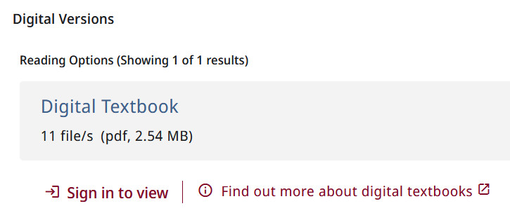
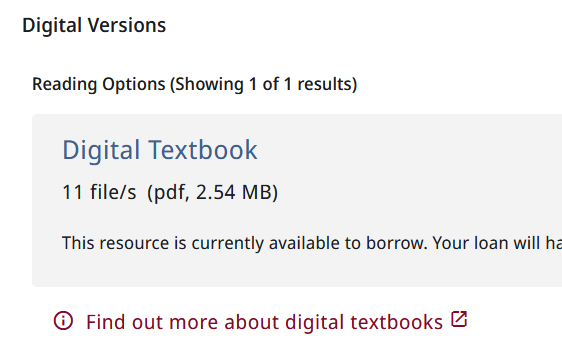

# Message for CDL titles
Component does two things:
* Displays a link leading to a FAQ explaining digital loans
* If user is not signed in, displays a sign-in prompt.

## Link to FAQ
The URL is imported via app.constants. If adapting this component, you can define it explicitly in the ts file linkTarget property, or remove that property and include the url as the href value in the template.

To determine if the title in the full display is CDL, the component checks hostComponent to see if
* the title's delivery includes a digital service
* the representation label includes the string *digital textbook* - this is a Los Rios convention.

## Sign-in prompt
This solution is a little odd. First, the NgRx store is queried to see if the user is currently signed in. If not signed in, the sign-in prompt is displayed, and when the user clicks it, the code simulates clicking an existing sign-in prompt on the page using a DOM query. If a sign-in button is not found, it opens the user account area where a sign-in button will be shown and scrolls to it. It didn't seem possible to include NDE's native sign-in action in the component.

## Screenshots

### User not signed in

### User signed in

